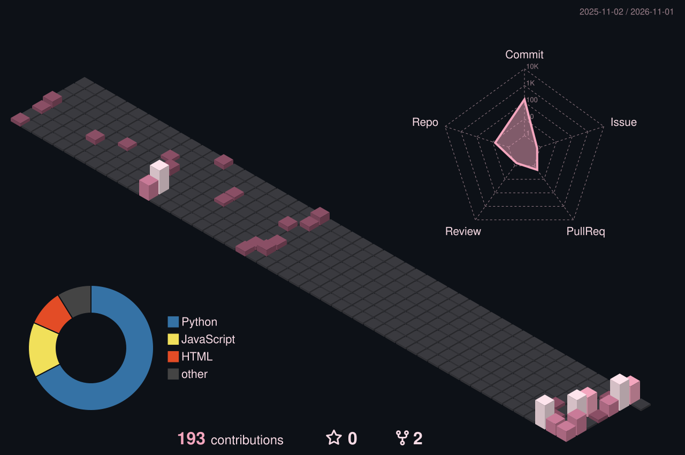
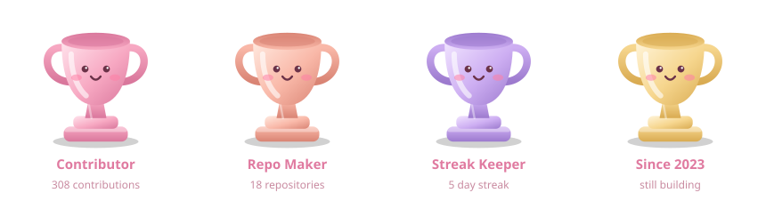

  

 

### About

I make small, thoughtful things for the web, somewhere between code and design.
I like clean interfaces, calm colours and projects that feel a little bit alive.

Based in Kerala, India. Currently building AI-powered products: RAG pipelines, LLM tooling, multimodal systems (vision, speech, OCR) and the interfaces around them.

 

### Tech stack

Intelligence

  
  
  
  
  
  
  
  
  
  
  
  

Perception

  
  
  
  
  
  

Craft

  
  
  
  
  
  
  
  
  
  
  

Foundations

  
  
  
  
  
  
  

 

### Activity

  

  

### Trophies

  

 

### Find me

[heyadithya.me](https://murmur.heyadithya.me/) &nbsp;·&nbsp; [github.com/Adithya6ramesh](https://github.com/Adithya6ramesh)

